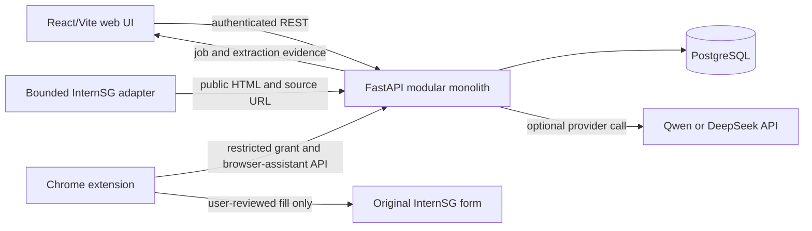
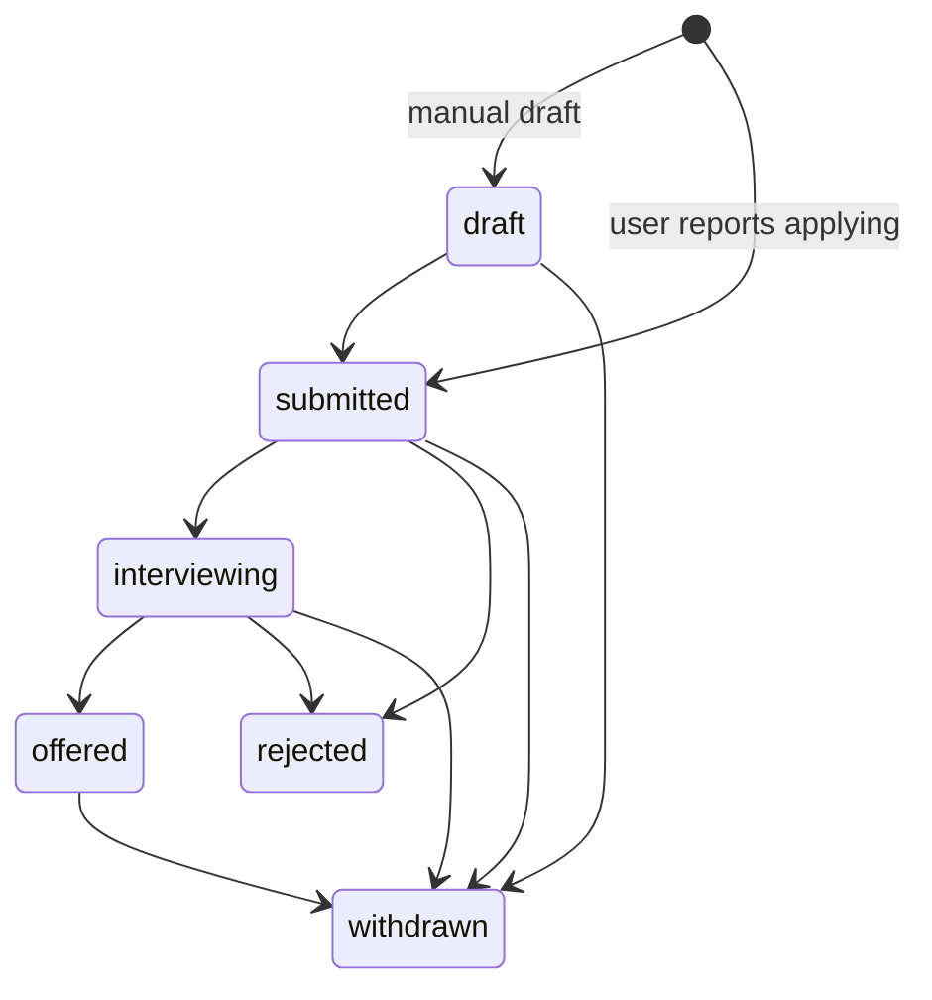

# Course closeout baseline (working draft)

Evidence snapshot: 15 October 2026, `main` at `f9d76eb` (merged PR #28). This is a retrospective description of the implemented system, not a claim that every original plan was completed or that the team made these decisions on this date. The proposal and development document remain historical baselines. Verify this document again before the final report.

## Course and schedule boundary

The local 20 August 2026 SWE5006 briefing deck, slides 3, 5–6, 9–10 and 13–15, calls for a working system, architecture and detailed design, design-pattern rationale, tests/DevSecOps scripts, agile artifacts, a report and a readable presentation. Slide 13 assigns a non-company-sponsored project 20% presentation and 80% report (including 5% peer assessment). Slide 14 says peer assessment concerns contribution, not hours alone.

The same deck's **slide 7** lists **tentative, superseded** dates of 3–4 November 2026 for presentation and 10 November 2026 for report submission. The [updated Canvas announcement](https://canvas.nus.edu.sg/courses/100094/discussion_topics/485346), posted 31 August, instead sets the presentation for **26–27 October 2026** and the **final report deadline at 1 November 2026, 11:59 pm Singapore time**. The [Team 9–16 presentation announcement](https://canvas.nus.edu.sg/courses/100094/discussion_topics/485368) lists Team 9 at **9:30–10:15 am on 27 October 2026**, confirmed by its Zoom event time. Its title still says 26 October; treat that as a title/body discrepancy, not evidence that Team 9 presents on the 26th. These were the Canvas pages visible on 15 October; watch for later instructor changes.

Canvas's [Project Report Template for Practice Module folder](https://canvas.nus.edu.sg/courses/100094/files/folder/Project%20Report%20Template%20for%20Practice%20Module) lists `SWE5006 - Project Report Template for Practice Module.docx`, last modified 1 September 2026. Its eight-page online preview was checked against the outline extracted from a same-named local copy; the headings and substantive instructions matched, although the files were not byte-compared. The Canvas Assignments list visible on 15 October showed only earlier progress-report/proposal assignments, not a final-report upload link. Do not invent that link or claim final submission is open.

### Final report template crosswalk

| Template section | Working evidence or remaining work |
|---|---|
| 1 Introduction: background, business needs, stakeholders, scope and quality attributes | Proposal and development document plus this baseline; reconcile current implementation with original scope |
| 2 Project Conduct: plan, status, metrics and each member's ownership | `agile/PROCESS_EVIDENCE_INDEX.md`; actual sprint records, estimates, milestone dates and member-confirmed effort remain necessary |
| 3 System Design: architecture, analysis-to-design transition strategies, use-case model, analysis/design models, design problems/patterns and database schemas | Code and design notes give starting evidence; complete UML diagrams and verify each pattern's before/after design and implementation lineage |
| 4 DevSecOps and Development Lifecycle: source control, CI and CD | CI workflow and local Docker evidence; do not label Compose startup or CI build as automated CD |
| 5 Individual members activity contribution summary | Requires member confirmation, including non-code work |

The template explicitly asks for **at least one in-scope use case and one design problem per team member**. Each use case needs an analysis class diagram, analysis sequence diagram(s) for major flows, design class diagram and design sequence diagram(s). Each design problem needs its pre-pattern problem, candidates and selection rationale, static/dynamic design diagrams before and after, and implementation decisions. The current Markdown closeout files are source material, **not** a template-compliant final report.

## Scope and use-case numbering

Use the proposal's UC01–UC08 as the stable final identifiers. Preserve the development document's different numbering in the crosswalk; do not renumber old issues, reports or figures.

| Final ID | Scope | Proposal ID | Development-document ID | Origin |
|---|---|---|---|---|
| UC01 | Register, sign in and account isolation | UC01 | UC01 | Original MVP |
| UC02 | Browse and filter jobs | UC02 | UC02 | Original MVP |
| UC03 | Job detail, source link and favorites | UC03 | UC03 + UC04 | Original MVP |
| UC04 | Maintain profile and resume metadata | UC04 | UC05 | Original MVP |
| UC05 | Ingest, normalize, deduplicate and inspect jobs | UC05 | UC06 | Original MVP |
| UC06 | In-platform form mapping, human review and internal save | UC06 | UC07 | Original MVP, later implemented |
| UC07 | Application records and reported status | UC07 | UC08 tracking portion | Original MVP, frontend completion in this branch |
| UC08 | Admin source/crawl visibility and audit | UC08 | UC08 audit portion and other admin sections | Original MVP; acceptance incomplete |
| EV01 | Evidence-backed recommendation and match analysis | — | — | Later scope evolution, PR #28 |
| EV02 | Extension authorization and InternSG form fill assistance | — | Phase 2 stretch discussion | Later scope evolution, PR #28 |
| EV03 | Saved-profile reuse for external form preparation | — | Phase 2 stretch discussion | Later scope evolution, PR #28 |

The original plan also mentioned additional public sources, reminders, resume-document parsing and analytics. These are **planned/stretch**, not demonstrated current capabilities. `ResumeDocument` stores metadata; do not imply that uploaded resume text drives current recommendation analysis.

## Implemented architecture and trust boundaries

`backend/app/main.py` composes auth, jobs, profile, ingestion, extraction, matching, recommendation, assistant, application and browser-assistant routers. The web UI and extension are different clients. An original employer form remains outside JobPilot's trust boundary. Filling fields, saving a JobPilot record and receiving an employer submission are different events. The extension cannot use the web token as a general-purpose API credential; its authorization and allowed operations are defined in `backend/app/auth/extension_router.py` and `docs/member3/EXTENSION_AUTH_CONTRACT.md`.

Main persisted relationships in `backend/app/db/models.py`: `User` owns one `UserProfile`, many `Favorite` and `Application` records; `JobSource` owns `JobPosting` and `CrawlRun`; a `JobPosting` may have `ApplicationForm` fixtures and append-only `JobExtractionRun` history; `FormMappingRecord` links a user/form and optionally an application. `Application` has a unique `(user_id, job_id)` constraint. That constraint makes an old assistant record conflict with a new manual record for the same job.

Key interfaces: `GET /jobs`, `GET /jobs/{id}`, `POST /jobs/recommendations`, `POST /jobs/{id}/match-analysis`, `GET/PUT /profile`, favorite routes, `POST /assistant/map-fields`, `POST /assistant/applications`, and `POST /jobs/{id}/applications` plus `GET/PATCH /applications`. The last group is account-scoped and paginated; its canonical statuses are `draft`, `submitted`, `interviewing`, `offered`, `rejected`, `withdrawn` (`backend/app/applications/service.py`). A saved `method=assistant, status=submitted` record is **not** evidence of delivery to an employer.

### Complex journeys and failure behavior

1. **Ingestion and extraction.** `SourceAdapter.collect` isolates source HTML from persistence. The InternSG adapter enforces bounded collection and source policy. Normalization/deduplication is followed by database upsert; `JobExtractionRun` retains input/pipeline hashes and a running lease. Reuse is valid only for matching current inputs and pipeline; failed or stale extraction is not presented as a fresh result. See `backend/app/ingestion`, `backend/app/job_extraction`, and their tests.
2. **Evidence-backed matching.** `backend/app/job_matching.py` and `backend/app/job_recommendations.py` compare explicitly stored profile signals with extracted JD evidence. They retain `unknown`/manual-review outcomes and reject stale extraction; no invented percentage or exhaustive qualification claim is justified. Account changes and late responses are guarded in the client surfaces.
3. **Profile-to-form reuse.** A saved profile is fetched again for each job. The platform review and extension bridge require confirmation, preserve occupied fields, and do not handle CAPTCHA or final external submission. Unsupported fields remain for the user. See `frontend/src/components/ApplicationPreparation.tsx`, `extension/`, and `docs/member3/PLATFORM_APPLICATION_BRIDGE.md`.
4. **Application records.** The backend rejects duplicate `(user, job)` creation with 409 and enforces transition rules. This branch adds explicit user-reported creation, paginated history and status controls to the web UI without changing that contract. Old assisted records remain visibly distinct; conversion needs a separately agreed data/API design.

This is a state **diagram** for a transition table, not a claim that the GoF State pattern was implemented. Assistant/extension records may carry `submitted` in historical data with a different meaning.

## Design patterns actually visible in code

| Problem | Pattern and implementation | Benefit and cost | Evidence |
|---|---|---|---|
| Extraction and form mapping need replaceable model backends | Strategy: `LLMProvider` protocol with Qwen, DeepSeek and deterministic Mock implementations in `backend/app/llm` | Stable consumer contract and offline tests; provider capability/errors still require explicit handling | `backend/tests/llm/test_live_providers.py`, `backend/tests/job_extraction/test_provider_contract.py` |
| External job sources have different page formats | Adapter: `SourceAdapter` and `InternSGAdapter` in `backend/app/ingestion` | Parser/source policy stays outside persistence; only InternSG is a live adapter today, so multi-source extensibility is a design property, not proven production breadth | `backend/tests/ingestion/test_internsg_adapter.py` |
| OpenAI-compatible providers share transport/retry/parse sequence but may differ in payload | Template Method: `OpenAICompatibleChatProvider.generate_structured()` fixes the sequence and calls `_build_payload()`; `DeepSeekProvider` overrides that hook | Avoids duplicating retry and parse logic; only applicable to compatible transports | `backend/tests/llm/test_live_providers.py` |

The sequential ingestion function is not presented as Template Method. A simple constructor is not claimed as Abstract Factory. These examples were identified from the final code during closeout, not asserted as contemporaneous team meeting decisions.

## Quality attributes and decisions to explain

| Attribute | Implemented mechanism | Limit of evidence |
|---|---|---|
| Reliability | Unique constraints and ingestion dedup; extraction input/pipeline hashes, lease/recovery; application conflict and transition checks | No measured uptime or external-site availability guarantee |
| Security | Account-scoped endpoints, expiring/revocable credentials, restricted extension grant, bounded source policy, no committed model key | No claim of a complete security audit |
| Maintainability | Modular routers/services, typed schemas, provider/source interfaces, documented contracts | Future replacement cost not measured |
| Testability | Offline model/source fixtures, backend API tests, isolated browser tests and CI gates | Synthetic form checks are not real employer delivery |
| Performance | Backend pagination and bounded ingestion | The current web browse page fetches only the first 100 jobs for a search and filters that loaded set; no benchmark supports the proposal's response-time target |

`.github/workflows/ci.yml` runs structure/Compose validation, backend Ruff/pytest with an 85% coverage gate/Semgrep/pip-audit, frontend ESLint/build/**high-severity npm audit** (added in this branch), extension checks/browser tests/audit, and a Docker backend build. This is **CI and build validation**, not automated release/CD to a running environment. `docker-compose.yml` and `docs/member3/CLEAN_DEPLOYMENT_ACCEPTANCE.md` describe repeatable local deployment; their October 14 results are historical checks, not this branch's deployment proof.

## Open decisions and unverified work

- **Needs team decision:** How, if at all, to convert a historical `assistant` record to a user-reported application while preserving method, confirmation data and audit history. Do not rewrite old rows or count all `submitted` records as real applications.
- **Needs current external evidence:** Full team sprint/review/retro records, member-confirmed use-case/pattern ownership and effort, the final-report upload link when published, and a reproducible installed Chrome extension acceptance record on the final reviewed build. A user-reported field-fill run on 15 October is partial evidence, not that final-build check. Recheck Canvas before submission for any later changes.
- **Not verified here:** Live employer receipt, CAPTCHA/final submit, live model quality in a deployed environment, actual recommendation qualification accuracy, production performance, automatic CD.
- **Known original-plan gaps:** Additional data sources, reminder/analytics features and resume-text parsing are outside this closeout scope.

Use `REQUIREMENTS_TRACE.md` and `DEMO_ACCEPTANCE.md` for the implementation/test/demo cross-reference; use `agile/PROCESS_EVIDENCE_INDEX.md` for provenance of process claims.
