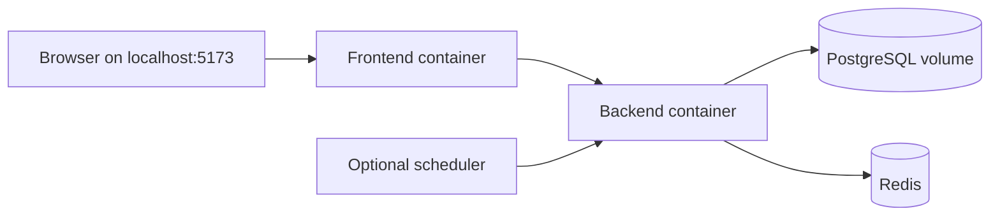

# Infrastructure as code: present scope and gap

Snapshot: 28 October 2026, `main` commit `66eacc9`.

## What is implemented

The versioned [`docker-compose.yml`](../../docker-compose.yml) declares the local PostgreSQL, Redis, backend and frontend services, plus an optional scheduler profile. It specifies image/build sources, localhost port bindings, environment references, health checks, dependencies and a database volume. The [backend](../../backend/Dockerfile) and [frontend](../../frontend/Dockerfile) Dockerfiles define their images, non-root users and health checks. The [CI workflow](../../.github/workflows/ci.yml) checks `docker compose config -q` and builds/starts the stack for API/frontend smoke checks. The Compose configuration also validated locally on **28 October 2026** with exit code 0.

This is a **reproducible local container deployment definition**. It is appropriate to demonstrate as a small infrastructure-as-code practice, but it does **not** prove a cloud IaC deployment, continuous delivery, auto-scaling, high availability or production secrets management. [Checkov](../../.github/workflows/security-scans.yml) scans the Dockerfiles with `--framework dockerfile`; it does not validate the Compose file or provision a cloud environment.

## What a genuine cloud-IaC deliverable would require

A target cloud/account and deployment topology must first be chosen. A reviewed Terraform/Pulumi plan would then need to define network boundaries, compute and image registry, managed database/Redis or documented alternatives, secret injection, ingress/TLS, access rules, persistent storage, monitoring and teardown. Validation would need a checked plan and an actual apply/smoke/destroy record in an authorized account. **None of those steps has been completed or tested for JobPilot-SG.** Do not add a decorative cloud template to the report as if it were deployed.

For the final presentation, show the Compose source, `docker compose config -q` result and Docker smoke job, and label the slide **Local deployment as code**. If asked about cloud IaC, state the above boundary directly.
