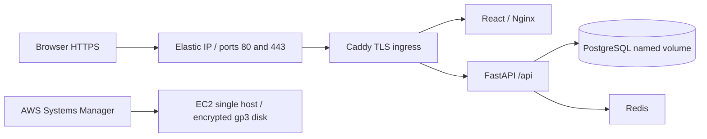

# Infrastructure as code: verified local and AWS scope

Snapshot: **30 October 2026**. The user explicitly authorized a real AWS deployment,
superseding the earlier decision to keep this project local-only.

## Real AWS deployment

The versioned [CloudFormation template](../../infra/aws/cloudformation.yaml) was
validated, reviewed through a change set, and **executed** in Singapore
(`ap-southeast-1`). Stack `jobpilot-sg-demo` reached **`CREATE_COMPLETE`** with all
16 declared resources complete. Its bootstrap signal requires a successful trusted
HTTPS health check and frontend document check, rather than EC2 creation alone.

- Website: <https://52.77.50.207.sslip.io>
- API health: <https://52.77.50.207.sslip.io/api/health>
- Application source: `7fb4bf26d89548be63eec1a4a42b5b400e8fdeae` (deployment branch;
  includes the non-root Nginx startup correction). This is not a claim that the
  branch has been merged into `main`.
- Infrastructure source: [template and operating guide](../../infra/aws/README.md).
  The template fetched back from AWS exactly matched the local source after
  newline normalization; its SHA-256 is in the evidence.

The stack owns its VPC/subnet/routes, security group, EC2 network interface,
Elastic IP, generated SSM role/profile and EC2 host. Application services use
Docker Compose on that host. PostgreSQL, Redis and backend ports are not exposed
on the host; the security group admits only web traffic. Secrets are generated
on the instance in a mode-600 `.env` file. No local model key or developer
database was uploaded. HTTPS uses sslip.io DNS and ACME, without an owned domain.

## Verified evidence

Evidence folder: [aws-20261030](evidence/aws-20261030/).

| Check | Result / evidence |
|---|---|
| Template validation | Local `cfn-lint` 1.59.0 and AWS `validate-template` passed; [change set](evidence/aws-20261030/change-set.json) contains 16 additions |
| Real resource creation | Stack and all resources `CREATE_COMPLETE`; [runtime verification](evidence/aws-20261030/runtime-verification.json) |
| HTTPS and network | Trusted TLS certificate, HTTP 308 to HTTPS, and management/data ports unreachable from the external test client; [network/TLS](evidence/aws-20261030/network-tls.json) |
| External API flows | Two synthetic registrations, login/current-user, profile write/read, private-profile isolation and unauthenticated rejection passed; [cloud smoke](evidence/aws-20261030/cloud-smoke.json) |
| Browser wiring | Edge registration and login reached the deployed `/jobs` page through the frontend's compiled same-origin `/api`; no localhost API address was used |
| Database and persistence | Actual PostgreSQL 16.15, `postgresql+psycopg`; database container recreation and backend restart preserved 4 users, 4 profiles and 2 sandbox jobs; [runtime verification](evidence/aws-20261030/runtime-verification.json) |
| Post-recreation access | HTTPS frontend/API checks passed again; [read-only smoke](evidence/aws-20261030/cloud-smoke-after-recreate.json) |
| CI | Infrastructure commit `82141d2`: [all six CI jobs passed](https://github.com/ensommeille/JobPilot-SG/actions/runs/41006683822); [security workflow completed](https://github.com/ensommeille/JobPilot-SG/actions/runs/41006683774) |
| IaC policy scan | Checkov 3.4.0: Dockerfiles 130 pass / 0 fail; CloudFormation **11 pass / 1 fail**, 0 skips / parsing errors; [summary](evidence/aws-20261030/checkov-summary.json) |

The remaining CloudFormation policy finding is **CKV_AWS_260**, public TCP 80.
It is accepted for ACME HTTP verification and automatic HTTPS redirection;
application credentials use HTTPS. No skip or suppression was added. The
Checkov job remains advisory (`--soft-fail`), so a green workflow does not mean
zero policy findings. Previous Dockerfile-only scan counts are historical and
do not describe this new template.

## Limits and operating cost

This is now **real cloud infrastructure as code plus a verified application
deployment**. It is a single-host course demo, with no high availability,
autoscaling, managed PostgreSQL/Redis, automated backup or automatic CD pipeline.
It does not establish a production SLA or production secrets management.

The public job list currently contains **zero** jobs. The two initialized sandbox
records are intentionally excluded by application rules; no public source
ingestion is configured. LLM credentials and extension pairing are also not
configured. No employer submission or model call was made during verification.

The baseline estimate is about **US$0.85/day / US$25.80 per 730-hour month** before
traffic, tax and credit/free-tier deductions; see the [official-price evidence](evidence/aws-20261030/pricing.json).
This is not a spending cap. The service remains running. Stopping EC2 alone does
not remove disk and IP charges.

Named volumes survive container restarts/recreation on the host, but deleting
the stack deletes its root disk and demo data. Export required data before an
explicitly authorized teardown. A host reboot and stack destroy have **not** been
tested. The [runbook](../../infra/aws/README.md) documents creation, administration,
cost, fresh-stack reproduction and teardown commands.

## Existing local deployment

The original [docker-compose.yml](../../docker-compose.yml) remains the local
deployment definition for PostgreSQL, Redis, backend, frontend and optional
scheduler. Its localhost bindings and development defaults are not used as the
cloud ingress configuration. The earlier 28 October local deployment evidence
remains historical evidence of that local stack.
