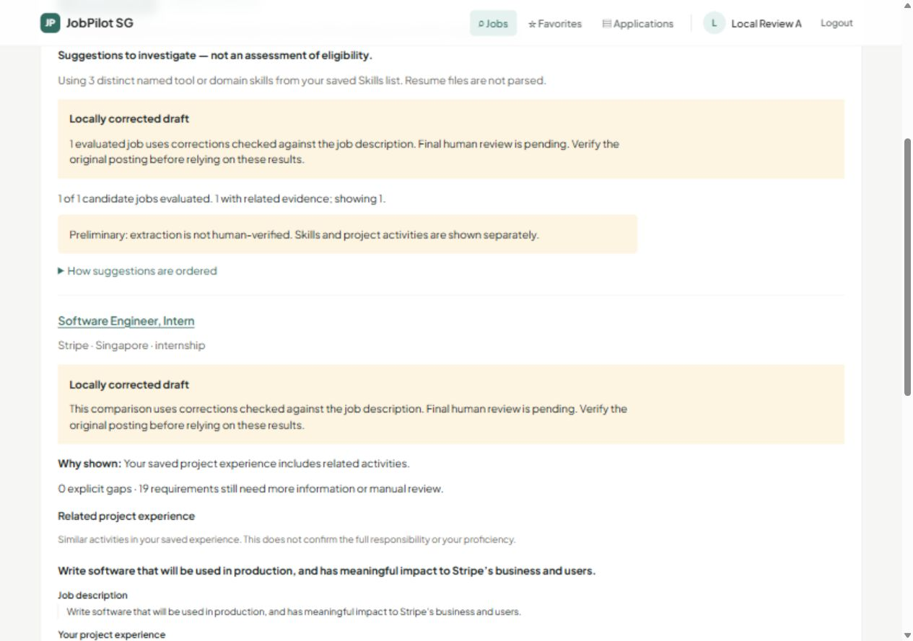
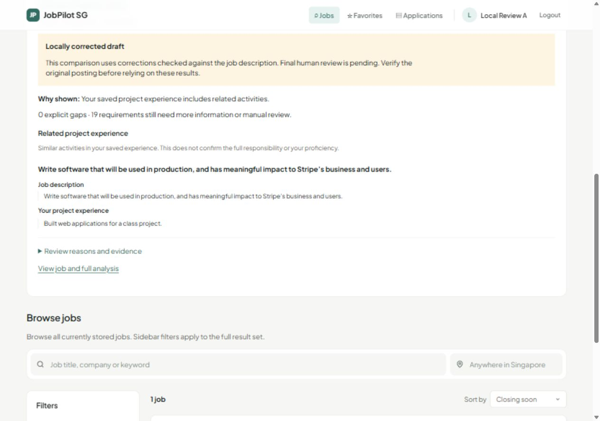

# Source-bound Stripe correction and local acceptance

This saved public Stripe Software Engineer, Intern posting (8130883) exercises
the local correction path. The original live output is retained separately from
the agent-authored correction. Final human review remains pending.

The two original concerns are resolved in this saved result: the summary uses
its own contiguous source quote, and qualitative programming experience is
present without inventing minimum work years. The correction additionally
preserves degree pursuit, project/classwork qualifiers and specialized/general
knowledge conditions, removes the team's background language list from applicant
requirements, and retains the three personal traits as unspecified requirements.

## Files and provenance

- `source.json`: saved public Greenhouse response and source URL.
- `input.json`: exact extraction input and derived input hash.
- `pipeline.json`: historical v5 configuration used for the one live generation.
- `result.original.json`: exact original result bytes, protected from Git newline
  normalization by `.gitattributes`.
- `extraction.corrected.json`: separate proposed correction.
- `review.changes.json`: eight replayable edits with original values, exact source
  quotes and offsets, reasons, hashes and pending-review status.

Original result ID: `d1b5e56f-b623-4cba-aff1-2bb33225c353`.

Input hash: `24ecc01bf9a9cf732d6fbae5ef98745f521032a6ccaf1c281edaa4412cfbab87`.

Original raw-file SHA-256:
`f400ef289b34b0af4f363311d402a8768c0f397c57c891b50bc6d20c0f7e52f0`.

Corrected canonical-JSON SHA-256:
`1812f65b701f9d5b7ae4d390e980ce8e296e66637c30ab6bddb6e98aff054689`.

The source URL is https://job-boards.greenhouse.io/stripe/jobs/8130883.
These files refer to a saved snapshot, not a claim that the posting remains open.
No API key, authentication token, user profile or database is included.

## Reproduce without a model call

Install the repository's backend and frontend dependencies as usual. From the
repository root, use the backend Python environment to run this PowerShell example:

```powershell
New-Item -ItemType Directory -Force data | Out-Null
python scripts/local_review_workspace.py `
  --artifacts "$PWD/docs/member3/examples/stripe-source-review-20261021" `
  --workspace "$PWD/data/stripe-source-review" `
  --port 18521 --web-origin http://127.0.0.1:15521
```

The workspace and artifact paths must be absolute. On other shells pass the
corresponding absolute paths. Pass a workspace path that does not yet exist; the
helper creates it and later reuses only that script-owned workspace. `data/` is
Git-ignored. The helper seeds only
the saved job and original run; it creates no account. It uses a separate SQLite
database, disables live providers and external connections, and listens only on
loopback. Restarting it preserves test profiles but requires signing in again.

In another terminal, start the frontend against that API:

```powershell
Set-Location frontend
$env:VITE_API_BASE_URL = 'http://127.0.0.1:18521'
npm run build
npm run preview -- --host 127.0.0.1 --port 15521 --strictPort
```

Open http://127.0.0.1:15521, register a disposable ordinary account, save its
profile, and use **Find jobs for me** / **Check my match**. This does not update an
existing deployment or submit an employer application.

The correction is opt-in through the server-owned `JOBPILOT_REVIEW_BUNDLE` set by
the helper. No client request can supply it. Without that setting the normal
matching path remains unchanged. A bad binding fails closed. This bounded local
format currently requires this eight-operation review; it is not a general
human-review editor or an approved live extraction.

## Observed acceptance, 2026-10-21

- Ordinary account with only Python, Java and Ruby: one corrected job evaluated,
  zero suggestions. Background technologies do not become applicant requirements.
- Ordinary account with completed experience
  `Built web applications for a class project. Implemented automated tests for the application.`:
  one Stripe suggestion with one related software-development activity. The UI
  shows the exact job quote and saved profile excerpt separately. It does not
  establish production experience, proficiency or full responsibility fulfilment.
- Empty profile or learning-only experience: no suggestions. A statement of no
  Java experience is not a gap for a job that does not require Java.
- Detail shows zero confirmed skill matches, zero explicit gaps and 19 unknown
  items. The 19 includes group/education/experience views of some of the same
  conditions; it is not 19 independent failed qualifications. Four other duties
  remain for manual review.
- Separate ordinary accounts retain only their own saved profiles. Unauthenticated
  access is 401, extraction administration is 403, client-supplied review payloads
  are rejected with 422. Both analysis and recommendations use `no-store`.
- The original live row and saved source/correction hashes remained unchanged.
  Both endpoints were tested with `include_experience=true` and v3 responses.

Local validation: **966 backend tests passed, 90.72% branch-inclusive coverage**;
**97 independent API assertions passed across 47 loopback requests**; frontend
lint/build, Ruff, changed-Python formatting and `git diff --check` passed. Desktop
and 390x844 responsive views were inspected; no browser warnings/errors or mobile
horizontal overflow were observed. Regression tests blocked external connections
and recorded zero attempts. CI is reported separately by GitHub.

There were **zero additional paid calls for correction, integration or acceptance**.
The saved original came from the earlier single authorized generation. The newer
v6 prompt has offline regression coverage but has not been live-generated again.
The teammate's historical database record was not accessed or changed.

Screenshots from fictional local test profiles:





[Mobile evidence view](../../evidence/stripe-source-review-20261021/recommendation-evidence-final-mobile.jpg).
